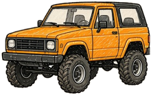
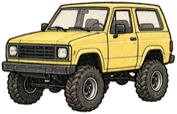
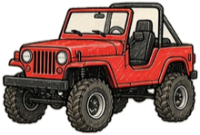
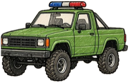
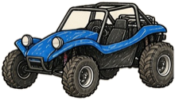
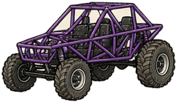
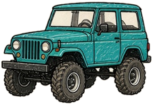
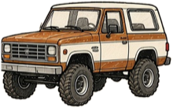
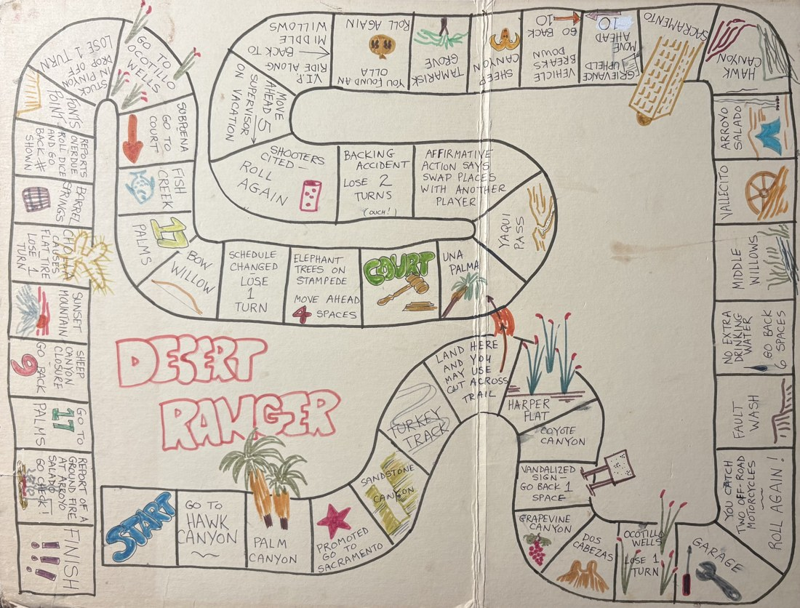

<h1 align="center">Desert Ranger</h1>

<p align="center"><em>A hand-drawn board game from the Anza-Borrego desert, now playable on any phone.</em></p>

<p align="center"><strong><a href="https://www.jprice.net/desertranger/">Play Desert Ranger</a></strong> &nbsp;·&nbsp; <a href="https://www.jprice.net/desertranger/about.html">About the game</a></p>

<br>

## The ranger who made it


**Jeffery Price** invented Desert Ranger. He was an Anza-Borrego ranger from 1980 to 1982, badge number **273**, and on the radio he was **R273**. The board is full of what a ranger's day is really like: a vandalized sign, a vehicle that breaks down, a supervisor on vacation, a trip to court.

The original board was drawn by hand. This web version keeps that artwork and the places, and adds the sounds of the desert and the voices of the people you meet along the way.

<br clear="left">

## How it plays

- **2 to 8 players**, each on their own phone, in the same room or over a phone call.
- Open the link, pick one of eight 1980s off-road rigs, and join with a 4-letter room code.
- Roll one six-sided die and race from **Start** to **Finish** across **52 squares**.
- Shortcuts, swaps, roll-again squares and lose-a-turn hazards decide who gets there first.
- Every phone hears the same dice, radio call, cheer or "awww" at the same moment.
- Play again after a win, nudge a slow player with Knock, knock, or try the solo demo against computer rivals.

<table align="center">
  <tr>
    <td align="center"><br><sub><b>Marigold</b></sub></td>
    <td align="center"><br><sub><b>Butter Scout</b></sub></td>
    <td align="center"><br><sub><b>Red Rocket</b></sub></td>
    <td align="center"><br><sub><b>Ranger Green</b></sub></td>
  </tr>
  <tr>
    <td align="center"><br><sub><b>Blue Buggy</b></sub></td>
    <td align="center"><br><sub><b>Purple Rail</b></sub></td>
    <td align="center"><br><sub><b>Teal Cruiser</b></sub></td>
    <td align="center"><br><sub><b>Two-Tone</b></sub></td>
  </tr>
</table>

<p align="center"><br><em>The board, from the original hand-drawn artwork</em></p>

## Real places in the park

Most of the place-name squares are real spots in Anza-Borrego Desert State Park and the desert around it, such as:

Palm Canyon · Sandstone Canyon · Turkey Track · Harper Flat · Coyote Canyon · Grapevine Canyon · Dos Cabezas · Ocotillo Wells · Fault Wash · Middle Willows · Vallecito · Arroyo Salado · Hawk Canyon · Sheep Canyon · Tamarisk Grove · Yaqui Pass · Una Palma · Bow Willow · 17 Palms · Fish Creek · Font's Point · Barrel Springs · Sunset Mountain

## About the park

Anza-Borrego Desert State Park is the largest state park in California, about 600,000 acres in San Diego County with hundreds of miles of dirt roads, wilderness areas and hiking trails. It was created in 1932 and takes its name from the explorer Juan Bautista de Anza and *borrego*, the Spanish word for sheep.

- [Anza-Borrego Desert State Park (California State Parks)](https://www.parks.ca.gov/?page_id=638)
- [Anza-Borrego Foundation](https://theabf.org)

## Credits

- **The game and the board:** Jeffery Price, R273.
- **Dice sounds:** [Casino Audio by Kenney](https://kenney.nl/assets/casino-audio) (CC0).
- **Crow:** [TheKingOfGeeks360 on Freesound](https://freesound.org/people/TheKingOfGeeks360/sounds/860982/) (CC0). **Coyote:** [Gerent on Freesound](https://freesound.org/people/Gerent/sounds/558725/) (CC0). **Red-tailed hawk:** [craigsmith on Freesound](https://freesound.org/people/craigsmith/sounds/479610/) (CC0).
- **Voices:** the characters you hear on the radio are computer-generated for this game.
- **Wind, crickets, radio effects and the crowd cheer and "awww":** original sounds made for the game.

Invented by Jeffery Price, R273. &copy; 2026 Jerod Price. All rights reserved.

---

# For developers

**Status:** Wave 1 went live on Oct 3, 2026 (tag `milestone-1`) and Wave 2 on Oct 5, 2026, on the client's own PHP and MySQL hosting. The plan from here: the playable game is live, then sound and voices keep improving, then launch. Open work and feedback are tracked as [GitHub issues](../../issues).

**What it is:** a plain PHP + MySQL server (works on PHP 7.4 and MySQL 5.7) with a vanilla JavaScript client: no build step, no framework. The browser polls the server about once a second; every sound is scheduled against a shared server clock so all phones play it at the same moment.

### Docs
- [Prototype: run locally, MAMP, how it works, test results, known gaps](docs/PROTOTYPE.md)
- [Deploy to the client's Network Solutions host](docs/DEPLOY-NS.md) and the [hand-off for an AI assistant doing it](docs/HANDOFF-NS-DEPLOY.md)
- Sound: [build log](docs/AUDIO-BUILD-LOG.md), [plan](docs/AUDIO-PLAN-AMBIENCE-RADIO.md), [research](docs/AUDIO-RESEARCH.md), [original hand-off](docs/HANDOFF-CLAUDE-AUDIO.md), [pronunciation table](docs/PRONUNCIATION-TABLE.md), and the script in `docs/audio-lines.json`. Every clip can be auditioned on `desertranger/audio/review.html`.
- [Build plan (the original M0 to M6 breakdown)](docs/PLAN.md) and [rules notes](docs/RULES-NOTES.md)

### What is where
| Folder | What |
|---|---|
| `desertranger/` | The game: server (`api.php`, `lib/`), client (`assets/js/`, `index.html`, `about.html`) and the shipped sound (`audio/`) |
| `board/` | Master board data (`desert-ranger.json`) |
| `tools/audio/` | The sound build: voice generation, speech and pronunciation checks, mastering, review page |
| `dev/` | Tests and helpers: browser tests, a mock API, the deploy folder builder and live-site checker, the test-room cleanup SQL |
| `design/` | Design sources, including the **pitch sheet** generator (`design/pitch/`, two pages, `make.sh`) |
| `docs/` | Plans, runbooks and logs (and `docs/img/` for this README) |
| `host-test/` | A hosting-capability probe, for checking a new host before deploying |

### Run the tests
```
php desertranger/tests/rules_test.php                      # the rules engine (45 checks)
php desertranger/tests/simulate_game.php http://localhost:8888/desertranger 4   # a full game over HTTP
php desertranger/tests/demo_game.php http://localhost:8888/desertranger          # solo demo
php desertranger/tests/wave2_game.php http://localhost:8888/desertranger         # games counter, Play again, Knock, knock
node dev/audio/landing_test.js                              # which radio call a landing gets
node dev/audio/browser_test.js                              # headless Chrome, mock server (needs: cd dev/e2e && npm install)
bash dev/verify-deploy.sh https://YOURDOMAIN/desertranger   # read-only live-site check (add --full to play games)
```
The game tests use the local MAMP address shown above; point them at your own address if it differs. `verify-deploy.sh` takes the live address (replace `YOURDOMAIN`).

### Shipping an update
`bash dev/make-deploy-folder.sh` builds an upload-ready copy (never `config.php`), upload only the changed files, then run `dev/verify-deploy.sh`. Details are in [docs/DEPLOY-NS.md](docs/DEPLOY-NS.md).

Images, fonts and the crowd clips for the game itself are not in git: unzip `desertranger-assets-for-mac.zip` at the repo root (or run `dev/make-assets.sh`). The pictures in `docs/img/` are small copies used only by this README.
